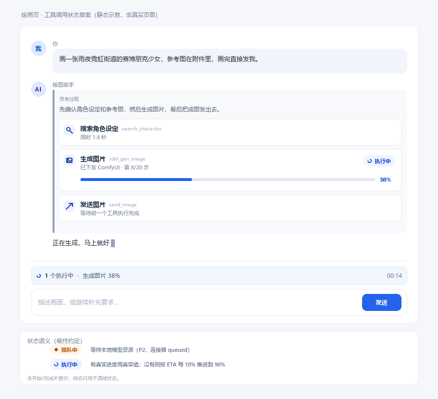

# 工具调用状态可视化 · 可行性研究

> 研究对象：AIWuxia 自带网页前端（`save/` 下的 `painter.html`、`custom.html` 等页面与公共层 `ai-protocol.js`）。
> 本报告最初只做分析与设计；其中的最终方案已在后续实现（代码改动见仓库，不再局限在 `reports/`）。
> 结论基于当前仓库代码（提交 `b0e8687`）逐个类核对，关键位置在文末索引。
>
> **实现更新（2026-11-20）**：代码已按最终约定落地——前端只显示“排队中”和“执行中 + 进度”，
> 不显示“未开始/完成”；本地模型部署端新增 `eta`，没有真实进度时按 10% 一档推进到 90%。
> 下文第三节及状态表保留为设计推演，**最终行为以代码与 README 协议表为准**。

---

## 一、结论

**可行，而且不需要动模型调用层。** 推荐做法是给工具调用补一条**独立的状态事件流**（不写历史、不回传模型），再加一份**重连快照**；前端把现有“调用工具：xxx”行升级成带状态、计时、（可选）进度的卡片。

分三期落地：

| 阶段 | 内容 | 后端改动 | 前端改动 | 估算 |
|---|---|---|---|---|
| **P0**（可选） | 绘画页工具行加“调用中”转圈 + 计时，不改协议 | 0 | ~30 行 | 0.5 天 |
| **P1**（推荐 MVP） | `tool_status` 生命周期事件 + `call_id` + `status.toolCalls` 快照；绘画页完整状态 | ~450 行 / 7 个文件 | ~210 行 / 2 个文件 | 2–3 天 |
| **P2** | 接入本地模型 `progress`（queued/running/百分比） | ~250–350 行 / 6–8 个文件 | ~60 行 | 1–2 天 |
| **P3**（按需） | `custom` 页活动条、其它聊天页、历史持久化、服务端联网/Codex 细化 | 按页面 | 每页 50–120 行 | 每页 1–2 天 |

**三个必须先知道的事实：**

1. **网页侧只有绘画页会实时显示工具调用。** `PainterSession` 重写了 `onReasonerAppend` 并把工具调用写成 `tool_call` 帧；`galgame` / `trpg` / `custom` 等页面用的 `WebSocketAISession` 没有这个重写，实时工具调用根本不下发，历史重放里的 `thinking` 段这些页面也不渲染。（`AIGroupSession` 也重写了 `onReasonerAppend`，但只累积给 QQ 文本流，不产生网页帧。）
2. **前端现在拿不到“完成”和“身份”。** `tool_call` 帧没有 `call_id`，工具结果又从不实时下发（`writeReasonerFrames` 只处理文本、ToolCall、ServerToolUse，忽略 ToolContent），所以前端无法自己判断某个工具何时结束，也串不起“第几个工具”。
3. **本项目没有全局工具调度队列。** 同一批调用默认在线程池里并发启动，工具层没有“超出并发上限就等待”的机制。工具真正开始前的等待（顺序屏障、等待授权）统一显示为**未开始**；本地模型连接器回的 `queued` 是**排队中**（等资源锁），两者是不同层的状态，不需要再细分。

---

## 二、现状：一次工具调用到底发生了什么

### 2.1 后端时序

```
模型 SSE ──tool_calls 增量──► ToolCallCollector
                                  │ finish_reason == "tool_calls"
                                  ▼
                    ToolCallContext.process(reasonerText)      ← 跑在 SSE 回调线程上
                    ├─ emit(ToolCallContent) ──► AIOutput.reasoner 流
                    │                              ├─► 写入本轮历史（持久化）
                    │                              └─► AISession.onReasonerAppend
                    │                                     └─► 仅 PainterSession：tool_call 帧 ×N（无 id）
                    ├─ for i: start(call) ──► TOOL_EXECUTOR（cached pool，整批并发）
                    │        └─ orderSensitive：先等此前所有同步调用结束（屏障）
                    ├─ awaitAll() ──► 按调用顺序取结果（快的也要等慢的）
                    └─ emit(ToolContent) ×N ──► 只写历史，没有实时帧
```

几个关键点：

- `process()` 在 SSE 读线程里同步执行，**工具跑多久，模型流就被阻塞多久**。长工具（生图、视频）执行期间模型不会再吐字，前端只能看到之前那个没有状态的工具行。
- 工具结果的 `emit` 发生在 `awaitAll()` 之后，而且是**按模型给的顺序**逐个发出的，不是“谁先完成谁先发”。所以即使只做前端提示，也无法从现有帧推断单个工具的完成时刻。
- 注册为 `async` 的工具会先等 1 秒：1 秒内完成直接返回结果，超时才登记成 `ToolTask` 并向模型返回“任务已创建”。异步任务通过 `ToolTaskListener` 通知会话，绘画页把它转成 `task` 帧。

### 2.2 前端现在能看到什么

| 页面 | 实时 thinking | 实时 tool_call | 实时 tool_result | task 帧 | status.tasks 快照 |
|---|---|---|---|---|---|
| `painter.html` | ✅ `thinking` 帧 | ✅（无 id） | ❌ | ✅ | ✅ |
| `custom.html` | ❌ | ❌ | ❌ | ❌ | ❌ |
| `galgame.html` / `trpg.html` / `ptrpg.html` | ❌ | ❌ | ❌ | ❌ | ❌ |
| QQ / 群聊（`AIGroupSession`） | 无前端 | 无前端 | 无前端 | 无前端 | 无前端 |

历史重放时 `batch_messages` 的每条 `thinking` 段会带 `tool_call` / `tool_result`，但只有绘画页会渲染它们，而且同样没有 `call_id`。

### 2.3 已经可以复用的设施

1. **`task` 帧 + `status.tasks`**（`PainterSession`）：已经是“长任务状态”的成熟形态，`created/done/failed` + `time`，前端有 `aiTasks`、`aiApplyTask`、`aiTaskElapsed`，输入框上方还有现成的 `pending-tasks` 样式（`painter.html`）。工具状态完全可以复用这套渲染与计时。
2. **本地模型 `progress` 协议**：连接器已经在发 `{"type":"progress","reqid":...,"status":"queued|running","progress":0.38,"message":...}`，语义就是“排队 / 已下发 / 百分比”。服务端 `LocalModelHandshaker.handleProgress` 目前**只记日志、延长超时**，`getTaskStatus(reqid)` 也无人调用——数据已经到服务端了，只是没往前端送。
3. **审批帧**：`toolApproval` 已经把工具名、参数、原因、超时发给前端；在它前后补一条“未开始（等待授权）”状态几乎零成本。
4. **计时器**：`aiTaskClock` 每秒一跳，`aiTaskElapsed` 已经能格式化为“x 分 y 秒”，扩展给工具行即可。

### 2.4 缺口清单

| 缺口 | 影响 | 补法 |
|---|---|---|
| `tool_call` 帧 / 历史段没有 `call_id` | 无法把开始、进度、完成、结果串成一条 | 帧里加 `call_id`（历史段同步加） |
| 没有开始/完成事件 | 前端不知道何时结束、跑了多久 | 新增 `tool_status` 帧 |
| 结果不实时下发 | 只能等整轮 `done` | 终态走 `tool_status`，结果仍走历史（不重复展示） |
| 没有“第几个/共几个” | 批量调用分不清 | 事件带 `round` / `index` / `count` |
| 没有快照 | 重连后状态丢失或永远转圈 | `status.toolCalls[]` |
| 只有绘画页有 UI | 其它页面看不到 | 协议层放公共状态，页面按需渲染 |

---

## 三、“未开始 / 排队中 / 运行中”在本项目里对应什么

先把语义钉死，否则 UI 会撒谎：

| 真实来源 | 代码位置 | 可观测性 | 建议状态 |
|---|---|---|---|
| 同一批调用并发启动 | `ToolCallContext.process` 的 `for` 循环 + `TOOL_EXECUTOR` | 启动几乎瞬时，没有队列 | `RUNNING` |
| `orderSensitive` 顺序屏障 | `process()` 中 `awaitAll(...)` 后 `start()` | 可在 `start()` 前精确知道“还没开始” | **`NOT_STARTED`（未开始）** |
| 工具需要审批 | `start()` 中 `approver.decide(...)` 阻塞 | 阻塞前后可精确发事件 | **`NOT_STARTED`（未开始，副文案“等待授权”）** |
| 异步候选的 1 秒观察窗 | `awaitExecution` + `submitAsyncNow` | 1 秒内不知道会不会转异步 | `RUNNING` → `ASYNC` |
| 本地模型资源锁（SDXL / ComfyUI / TTS） | 连接器 `progress.queued("等待本地模型资源")` | 连接器已上报，服务端丢弃 | **`QUEUED`（排队中，P2）** |
| 异步任务容量已满 | `manager.hasAsyncTaskCapacity()` | 直接拒绝，不排队 | `REJECTED` |
| 次数 / 轮次超限 | `start()` 里的各种上限判断 | 直接返回失败结果 | `REJECTED` |
| Codex / 子 agent 内部任务 | 各工具内部状态机 | 外层只看得到 `task` | 粗粒度 `ASYNC` + `task` 文案 |

**结论：** P1 能展示“未开始 → 运行中 → 完成/失败/取消/拒绝”；**“排队中”要等 P2**，因为它的唯一真实来源是本地模型连接器的 `progress.queued`。等待原因不单独做状态：“等待前一个工具”“等待授权”都归到未开始，原因写在副文案里。

### 3.1 “未开始”和“排队中”各指什么

| 状态 | 谁在等 | 状态从哪来 | 前端能拿到吗 |
|---|---|---|---|
| **未开始** | 工具还没执行：顺序屏障、等待授权 | `ToolCallContext`（P1 新增事件） | P1 后可以 |
| **排队中** | 工具请求已发出，卡在本地模型 `ResourceLock.acquire(...)`（显存/资源数量） | 连接器 `progress.queued("等待本地模型资源")` → 服务端 `handleProgress` | P2 才能拿到（目前服务端只记日志 + 续超时，`getTaskStatus` 无人调用） |

要点：

- **两档就够，不细分。** 未开始只表示“还没执行”，不区分是等屏障还是等授权；排队中只表示“在等本地模型资源”。
- **它们不是同一个时间点。** 本地模型 `queued` 到达时，工具其实已经 `start()` 了；因此 P2 接进度时，建议把这类工具的 `RUNNING` 延后到连接器明确回 `running`（或超过一个短窗口），避免 UI 闪一下“运行中”再变“排队中”。
- **覆盖不同。** 只有走本地模型的媒体工具会发 `queued`；`web_search`、`fetch`、`codex`、普通 MCP 工具没有这个状态，它们只会有“未开始 / 运行中 / 结束”。
- **“全局排队”仍然不存在。** `ToolCallContext` 用 `newCachedThreadPool`，每个调用立刻拿到线程；没有“全局并发上限 → 超出部分排队”这一层。本报告不建议为 UI 造一个假的全局队列。

---

## 四、方案对比

### 方案 A：纯前端（0 后端）

在 `painter.html` 的 `aiOnToolCall` 里给工具行加一个本地计时器和转圈，收到 `done` 或下一段正文时清掉。

- 优点：半天内能看到东西，零协议风险。
- 缺点：分不清排队/运行/完成；批量调用全部一起转圈；绘画一轮里模型多次调用工具时，转圈可能持续几分钟且没有任何阶段信息；重连后状态全丢。
- 适合：P0 过渡，或只想验证视觉。

### 方案 B：生命周期事件（推荐 MVP）

后端补 `tool_status` 事件（未开始/运行中/完成/失败/取消），带 `call_id`、轮次、序号、耗时；前端把事件合并进工具行；重连用 `status.toolCalls` 快照恢复。

- 优点：语义准确、通用（不依赖具体工具）、可扩展进度；对旧页面完全兼容（未知帧落到 `aiOnFrame` 空实现）。
- 成本：后端 7 个文件约 450 行，前端 2 个文件约 210 行。
- 风险：并发事件与现有帧的顺序需要前端按 id 做幂等合并。

### 方案 C：在 B 之上加真实进度

把本地模型的 `progress` 接到对应工具调用：状态（queued/running）+ 可选的 `progress`（0–1）+ 阶段文案。

- 真实粒度：H3/ComfyUI 能拿到步数比例；SD WebUI 目前连接器只发“已下发”，没有比例；TTS/SVS 只有阶段；即梦是轮询，没有官方进度。
- 成本：1–2 天，难点在 `reqid` 与 `call_id` 的关联（见第六节）。

### 方案 D：扩展面

- `custom.html`（配置型智能体）加一条输入框上方的活动条：`fetch`、`web_search`、`codex` 这类工具目前完全不可见。
- 其它页面：先在协议层放公共状态，页面按需渲染。
- 历史持久化：把耗时写进 `ToolContent` 之类的持久字段，刷新后仍显示“用时”，但会改存储格式，建议最后做。
- 服务端联网（DeepSeek `deepseek_web_search`）：`server_tool_event` 的 `call_started` 可以在流中提前显示“正在联网搜索”，目前只在结束时汇总成 `ServerToolUseContent`。

| 方案 | 能表达的状态 | 后端 | 前端 | 风险 | 建议 |
|---|---|---|---|---|---|
| A 纯前端 | 仅“调用中”+计时 | 0 | ~30 行 | 状态可能撒谎 | P0 过渡 |
| **B 生命周期** | 未开始/运行中/完成/失败/取消 + 计时（P2 加排队中） | ~450 行 | ~210 行 | 中 | **MVP** |
| C B+进度 | 再加阶段/百分比 | +250–350 行 | +60 行 | 中高（reqid 关联） | P2 |
| D 扩展 | 多页面/持久化/服务端工具 | 按需 | 按需 | 低–中 | P3 |

---

## 五、推荐方案（P1）设计

### 5.1 事件模型

新增两个小类（`llm/toolcall` 包）：

```java
public enum ToolCallState {
    NOT_STARTED,   // 已下发，尚未执行：顺序屏障 / 等待授权（原因放 message）
    QUEUED,        // 本地模型资源锁等待（P2），UI 显示“排队中”
    RUNNING,       // 工具本体在跑
    ASYNC,         // 已转后台任务
    SUCCEEDED, FAILED, CANCELLED, REJECTED
}

public final class ToolCallEvent {
    String callId;      // 模型 tool_call id，缺失时用 round:index 合成
    String tool;        // 原始工具名
    String name;        // 用户友好简述（ToolCallDisplay.getBrief）
    int round;          // 第几轮工具调用（1 起）
    int index, count;   // 本批第几个 / 共几个
    ToolCallState state;
    long time;          // 事件时间
    long durationMs;    // 终态：从真正开始执行到结束
    Double progress;    // 0..1，可空
    String message;     // 阶段文案 / 失败原因
    String taskId;      // 转异步时的任务 id
}
```

监听器挂到 `ToolCallManager` 上（每个 `AISession` 一个 manager，天然按会话隔离）：

```java
public interface ToolCallListener {
    void onToolCallEvent(ToolCallEvent event);
}
manager.setToolCallListener(listener);   // 与现有 setTaskListener 并列
```

### 5.2 事件触发点

全部集中在 `ToolCallContext`，不碰任何具体工具：

| 时机 | 位置 | 事件 |
|---|---|---|
| 本批调用写入流之后 | `process()` 里 `emit(toolCallContent)` 后 | 每个调用 `NOT_STARTED`（带 index/count/round） |
| 顺序屏障之前 | `start()` 前 | 保持 `NOT_STARTED`，不要提前发 `RUNNING` |
| 审批阻塞前/后 | `start()` 的 `decision.needsApproval()` 分支 | `NOT_STARTED` + `message="等待授权"` → 批准 `RUNNING` / 拒绝 `REJECTED` |
| 工具真正开始跑 | `supplyAsync` 返回后 | `RUNNING` |
| 单个工具完成 | 在 `start()` 给 future 挂 `whenComplete` | `SUCCEEDED` / `FAILED`（带 duration，**按完成时刻发，不等 `awaitAll`**） |
| 转异步任务 | `submitAsyncNow()` | `ASYNC` + `taskId` |
| 本地模型排队（P2） | 连接器 `progress.queued` → `handleProgress` | `QUEUED` + `message`；拿到锁后 `RUNNING` |
| 异步任务结束 | 现有 `ToolTaskListener` 回调 | `SUCCEEDED` / `FAILED` / `CANCELLED` |
| 用户停止 | `fillInterrupted` / `writeInterrupted` | `CANCELLED` |
| 超限/无权限/不存在 | `start()` 的提前 return | `REJECTED` + `message` |

实现注意：

- **不要拿 `AISession.onToolcall` 当状态源**：它由读流线程在消费 `ToolCallContent` 时触发，和 `process()` 里启动工具是并发的，既可能早于也可能晚于 `start()`，分不清未开始/运行中。
- 每个 `callId` 只允许一个终态（`AtomicBoolean` 或状态判断），避免 `whenComplete` 与 `awaitFuture` 重复发。
- `whenComplete` 能看到原始异常/`null`，比 `awaitFuture` 里被折叠成“tool发生内部错误”的文本更适合判断 `FAILED`。
- 发事件是“尽力而为”：监听器异常只打印，不能影响工具执行（与 `ToolTaskListener` 现有做法一致）。

### 5.3 事件通道选型

| 方案 | 覆盖范围 | 改动 | 评价 |
|---|---|---|---|
| 挂 `AIOutput`（像 usage listener） | 只有调用了 `state.setCurrentOutput(...)` 的应用（painter/custom/group/codex） | 每个 app 或 `setCurrentOutput` 里注册 | 覆盖不全，talk/galgame/trpg 不经过 |
| **挂 `ToolCallManager`** | 所有会话（manager 每个 session 一个） | 在 `AISession` 构造器注册一次 | **推荐**，天然按会话隔离 |

`AISession` 已经在这个位置注册了 `ToolTaskListener`，加一个并列的 `ToolCallListener` 即可。子 agent 的临时 manager 没有监听器，事件不会串到外层会话，符合预期。

### 5.4 会话聚合与快照

`AISession` 维护当前轮的活动表：

```java
Map<String, ToolCallEvent> toolActivities;   // callId -> 最新事件
```

- `onToolCallEvent`：更新表 → 调用受保护的钩子 `onToolCallStatusChanged(event)`（默认空实现）。
- `WebSocketAISession` 重写钩子 → 组装 `tool_status` 帧 → `sendFrame`（`ChannelGroup` 广播到所有标签页）。
- 新一轮 `onGenerateStart` 清空；`close` 清空；终态保留到本轮结束，供重连快照使用。
- `WebSocketAISession` 在 `onOpen` 的 `status` 帧和 `sendGenerationStatus` 里追加 `toolCalls` 全量快照；`PainterSession.statusExtras` 现在只放 `tasks`，两者互不影响（注意别覆盖基类字段）。
- `message_id` 取 `getCurrentWrite().item().getIdentifier()`；没有打开的写入时留空，前端按现有规则回退到最后一条 assistant 消息。

### 5.5 帧协议草案

下行新增：

```json
{
  "type": "tool_status",
  "call_id": "call_0f3a9c",
  "message_id": 1234,
  "round": 2,
  "index": 0,
  "count": 2,
  "tool": "sdxl_gen_image",
  "name": "生成图片",
  "state": "running",
  "time": 1732090000000,
  "durationMs": 1234,
  "progress": 0.38,
  "message": "已下发 ComfyUI · 第 8/20 步",
  "taskId": "",
  "reason": ""
}
```

- `state` 取值见 5.1；`durationMs`、`progress`、`taskId`、`reason` 可省略。
- `call_id` 用 snake_case，**不要复用 `id`**：`id` 在现有协议里已经是“消息 id”（`content`/`message`/`remove`/`audio`）或“任务 id”（`task`），复用它会让绘画页的 `painterTargetMessage(frame.id)` 产生歧义。
- 本轮 assistant 记录 id 用 `message_id`，不要用 `msgId`：后者在 `sendResult` / `sendbox` 里已经是客户端消息的 ACK id。
- 现有帧只加字段，不改语义：
  - 实时 `tool_call` 帧加 `call_id`；
  - 历史 `thinking` 段的 `tool_call` 加 `call_id`，`tool_result` 加 `tool_call_id`；
  - `task` 帧加 `callId`（`ToolTask` 已经有 `getToolCallId()`，只是没下发）。
- `status` 帧加 `toolCalls: [...]`（仅当前轮的未结束 + 已结束活动，数量很小）。
- 兼容性：旧版 `ai-protocol.js` 对未知 `type` 走 `default: aiOnFrame(frame)`，默认空实现；旧页面不会报错。旧版绘画页收到新增的 `call_id` 字段会忽略（`painterTargetMessage` 找不到消息 id 时本来就会回退到最后一条 assistant 消息）。

### 5.6 前端状态机

`ai-protocol.js`（公共层）：

```js
// data
aiToolCalls: [],          // [{call_id, name, tool, state, time, durationMs, progress, message, message_id}]
aiToolClock: 0,           // 与 aiTasks 共用 1 秒节拍
// methods
aiApplyToolStatus(frame)  // 按 call_id upsert；终态只保留最终值
aiToolElapsed(call)       // 复用 aiTaskElapsed 的格式
aiOnToolStatus(frame)     // 页面钩子
// routing
case 'tool_status': this.aiApplyToolStatus(frame); this.aiOnToolStatus(frame); return;
```

- `status.toolCalls` 用全量替换运行中的列表（与 `aiApplyTaskSnapshot` 同款），避免重连后残留。
- 活动条展示 `NOT_STARTED/RUNNING/QUEUED/ASYNC`（以及 P1 的授权副文案）：`NOT_STARTED` 计入“未开始”，`QUEUED` 计入“排队中”，`RUNNING` 计入“运行中”；终态从列表移除。

`painter.html`：

- `aiOnToolCall` 改为按 `call_id` 合并：已存在就更新，不存在才 push；`state` 初始为 `not_started`，副文案“等待前一个工具”。
- `aiOnToolStatus` 找到对应 `seg`，更新 `state`、`progress`、`message`、`startedAt`、`durationMs`；终态停表。
- 模板：状态点/转圈 + 状态文案 + 耗时；`running` 且有 `progress` 时多一行细进度条。
- 输入框上方的 `.pending-tasks` 复用为“工具活动条”：`1 个运行中 · 1 个未开始 · 生成图片 38% · 00:14`（有本地模型排队时再加“1 个排队中”）。

### 5.7 与 `task` / 审批的关系

- 转异步的工具会同时有 `tool_status(state=async, taskId)` 和 `task(created)`。建议前端**只保留一个入口**：工具行显示“已转后台任务”，活动条统一展示 `aiTasks`，避免重复转圈。
- 审批前发 `NOT_STARTED` + `message="等待授权"`，审批帧照旧发 `toolApproval`；用户拒绝时发 `REJECTED`，原因用审批结果里的 reason。
- 不要删除 `task` 帧：视频生成在本轮结束后还要跑几分钟，`task` + `status.tasks` 是现有页面“视频生成中”的唯一来源。

---

## 六、进度从哪来（P2）

### 6.1 已经存在的数据

连接器侧（`LocalModelClient.ProgressReporter`）已经在发：

```json
{"type":"progress","reqid":"...","status":"queued|running","progress":0.38,"message":"等待本地模型资源"}
```

各模型的真实粒度：

| 模型 | 状态 | 百分比 | 备注 |
|---|---|---|---|
| SDXL | queued / running | ❌ | `progress.running("已下发 SD WebUI")`，没有轮询 `/sdapi/v1/progress` |
| Qwen-Image（ComfyUI） | queued / running | ❌ | 同上 |
| H3 视频（ComfyUI） | queued / running | ✅ | `H3VideoApi.setProgressListener(progress::progress)` |
| SVS / TTS | queued / running | ❌ | 只有阶段 |
| 即梦视频 | 无 progress 报文 | ❌ | 云端轮询，只有任务状态 |
| MCP 远程工具 | `notifications/progress` 常量已定义但未处理 | 取决于服务端 | 需要 `McpClientBase` 接通知 |

服务端 `LocalModelHandshaker.handleProgress` 目前只做两件事：记录状态、把超时延后到 `now + progressTimeoutMs`。`getTaskStatus(reqid)` 没有任何调用方——**数据到服务端就断了**。

### 6.2 关联 `reqid` 与 `call_id`

媒体工具自己在内部生成 `reqid`（`UUID.randomUUID()`），比如 `SDXLAgentMcp` 在 `run()` 里调用 `LocalModel.require(ModelType.SDXL, UUID..., request)`。两条路：

**做法 1（显式，推荐长期）**
给 `LocalModel.require` 加一个可选 `Consumer<Progress>` 重载；`ToolCallContext` 给工具提供一个 `ToolProgress` 入口（新增 `ToolData.Builder.progressTool(...)`，只改 5–8 个媒体工具）。类型安全，但要多改几个工具。

**做法 2（零工具改动，适合快速验证）**
`ToolCallContext.start` 在调用 `data.tool.run(...)` 前后设置一个 `ThreadLocal<ToolProgress>`；`LocalModel.require` 在**调用线程**上取当前 sink，登记 `reqid → sink`；`handleProgress` 按 `reqid` 把状态转给 sink。媒体工具都在 `run()` 里同步调用 `require`，所以能捕获到。缺点是 `voice` 包要依赖一个中立的进度接口（可放到 `utils`），并且子 agent 内部的 `require`（不同线程）拿不到外层 sink。

无论哪种，都要做**节流**：同一 `call_id` 的进度最多 1 秒 1 帧，且只有状态变化、百分比变化 ≥1% 或文案变化时才发。

### 6.3 其它进度源

- **DeepSeek 服务端联网**：`server_tool_event` 的 `call_started` 在流中就能拿到，可以在最终 `ServerToolUseContent` 之前先发“正在搜索：xxx / 正在打开：xxx”。这是唯一能在“模型服务端执行工具”时给用户反馈的途径。
- **MCP 远程工具**：`McpProtocol.NOTIFICATION_PROGRESS` 已定义，`McpClientBase` 需要把通知路由到当前请求的 `progressToken`；只对支持 progress 的服务端有效。
- **Codex / DSH / 子 agent**：外层看到的是一个 `task`，内部事件在各自进程里，接入成本高。建议先用 `async + task 文案`，不要为它们改工具协议。

---

## 七、界面草案



（同一份草案的 HTML 版本：`reports/tool-call-status-mockup.html`；渲染脚本：`reports/tool-call-status-mockup.py`。）

设计要点：

1. **工具行内联在思考链里**，保持现有视觉语言（浅灰思考块、蓝色工具 chip），不新开一块面板。
2. 每行三段：`图标 + 用户友好简述（原始工具名作副标题）`、阶段文案、右侧状态。
3. 状态用颜色 + 形状双编码：未开始=灰色点，排队中=琥珀点（本地模型资源，P2），运行中=蓝色转圈，完成=绿色勾，失败=红色，取消=灰色，拒绝=红色描边。等待授权不单独做状态，用“未开始 + 副文案”。
4. 运行中显示耗时（`00:12`），完成显示总耗时（`用时 1.8 秒`）；计时复用 `aiTaskClock`。
5. 有真实进度时在第二行加 5px 细进度条 + 百分比；没有就不占高度。
6. 输入框上方保留一条**汇总活动条**：`1 个运行中 · 1 个未开始 · 生成图片 38% · 00:14`（P2 有本地模型排队时再加“1 个排队中”）。用户往上翻历史时也能看到“还在跑”。
7. 刷新后不回放计时，工具行仍显示“调用工具：xxx”和结果（与现状一致）；不要为了这个改历史格式。

---

## 八、风险与边界

| 风险 | 具体表现 | 缓解 |
|---|---|---|
| 事件与 `tool_call` 帧乱序 | `tool_status` 先到，前端还没有这一行 | 前端按 `call_id` **upsert**；缺行时用事件里的 `name/tool/index` 先建占位 |
| 终态重复/乱序 | `whenComplete` 与异步任务回调都发终态 | 服务端每个 `call_id` 只发一次终态；前端终态幂等（后到的非终态忽略） |
| 多标签页 | `sendFrame` 广播给所有 `conn` | 所有标签页都按 `call_id` 合并即可，无需定向 |
| 重连/刷新 | 状态丢失、转圈永远不停 | `status.toolCalls` 全量快照 + `sendGeneratingReasoning` 补发；前端离开页面时清理 |
| 状态写进历史 | 污染模型上下文、历史回放出现“运行中” | 状态只走新帧，**绝不**塞进 `ToolContent` / `ToolCallContent` |
| 旧前端 | 未知帧报错 | 现有 `ai-protocol.js` 的 `default: aiOnFrame` 天然兼容；旧绘画页忽略新字段 |
| 帧频率 | 多工具 × 多标签 × 每秒进度 | 进度节流到 1 帧/秒/调用；状态变化才发 |
| 用户停止 | 运行中的工具不会被打断，只能等它结束 | 已开始的保持 `running` 并提示“停止中，等待当前工具结束”；未开始的置 `cancelled` |
| 异步任务与工具行重复 | 两个转圈 | `taskId` 关联，工具行显示“已转后台”，活动条只留任务 |
| 未开始/排队中混淆 | 把顺序屏障或审批等待显示成“排队中”，用户以为在等本地模型 | 未开始只用于“还没执行”；排队中只来自本地模型 `progress.queued` |
| 服务端联网工具 | 没有本地执行生命周期 | 单独用 `server_tool_event` 生成合成事件；或先不做 |
| 审批状态与弹窗关联 | 审批 id 在 `ToolApprovalManager` 内部生成，事件里暂时拿不到 | 前端按工具名 + 时间关联；长期可在 approver 接口上回传审批 id |
| QQ / 群聊 | 没有 WebSocket 连接 | 监听器只在 `WebSocketAISession` 里发帧；`AIGroupSession` 保持空实现 |
| 部署 | 前端在 `save/`（运行时数据），不在 jar 里 | 改完要同步到服务器数据目录；`ai-protocol.js` 可能要加版本查询串避免缓存 |
| Java 8 | 不能用 record/新语法 | 事件类用普通 final 字段 + 构造器；接口用 default 方法 |

---

## 九、实施计划

### 9.1 文件清单（P1）

| 文件 | 改动 | 估算 |
|---|---|---|
| `llm/toolcall/ToolCallEvent.java` | 新增：状态枚举 + 事件对象 | ~120 行 |
| `llm/toolcall/ToolCallListener.java` | 新增：监听器接口 | ~40 行 |
| `llm/toolcall/ToolCallManager.java` | 字段 + `setToolCallListener` + `notifyToolCallEvent` | ~40 行 |
| `llm/toolcall/ToolCallContext.java` | 各触发点、终态去重、异步关联 | ~90 行 |
| `state/session/AISession.java` | 注册监听器、活动表、钩子、轮次清理 | ~80 行 |
| `state/session/WebSocketAISession.java` | `tool_status` 帧、`status.toolCalls` 快照、`tool_call` 帧加 `call_id`、历史段加 id | ~60 行 |
| `state/session/PainterSession.java` | 实时帧加 `call_id`、`statusExtras` 合并 | ~25 行 |
| `save/ai-protocol.js` | 状态表、路由、快照、计时 | ~120 行 |
| `save/painter.html` | 工具行状态 UI、活动条、合并逻辑 | ~90 行 |
| `README.md` | 协议表补 `tool_status` / `toolCalls` | ~30 行 |

合计约 **700 行、7 个 Java 文件 + 2 个前端文件**，2–3 人日（含绘画页联调）。

### 9.2 实施顺序

1. **协议先行**：定义 `ToolCallEvent` / 帧字段，先只发 `NOT_STARTED/RUNNING/SUCCEEDED`，用日志验证一轮里每个工具的事件顺序与次数。
2. **绘画页最小闭环**：`ai-protocol.js` + `painter.html` 把状态跑起来，确认重连快照和多标签页。
3. **补齐边界**：审批、拒绝、中断、异步任务、失败原因、旧页面回归。
4. **P2 进度**：先给全部媒体工具接“排队中/运行中”状态，再给 H3/ComfyUI 接百分比；SDXL 若要百分比，需要连接器轮询 `/sdapi/v1/progress`，那是另一个改动。

### 9.3 测试清单（手动）

- 单工具同步成功；多工具并发成功；含 `orderSensitive` 的屏障（确认前一个 `running`、后一个 `not_started`）。
- 工具失败（异常 / 返回 null）；次数超限；无权限；审批拒绝；审批超时。
- 用户中途停止：已开始的工具跑完、未开始的取消。
- 生图转异步（视频）：1 秒内完成 vs 转 `task`；完成后工具行与活动条都收敛。
- 生成中刷新/断网重连：状态从快照恢复，不重复、不残留。
- 两个标签页同时打开：两边状态一致。
- 旧版 `custom.html` / `galgame.html` 打开同一会话：不报错、不出现乱码帧。
- 长任务期间发消息：状态不阻塞输入、`status.generating` 正确。

---

## 十、不建议的做法

1. **把状态写进 `ToolCallContent` / `thinking`**：会被持久化、回放，还会进模型上下文；状态是瞬态的，必须走独立帧。
2. **纯前端猜“排队中”**：本项目唯一可观测的排队是本地模型连接器的 `progress.queued`，前端原本拿不到；屏障/审批属于“未开始”，不是排队，猜出来的状态会骗用户。
3. **让每个工具自己发帧**：重复、难统一、没法处理审批/超限/中断这些公共路径。
4. **在工具线程里同步等前端确认**：会拖慢生成，且前端断线就卡死；事件必须单向、尽力而为。
5. **为进度改 `Tool` 接口签名**：会影响所有工具；用可选重载或 `ThreadLocal` 兜底。
6. **复用 `id` 字段**：会和消息 id / 任务 id 冲突；用 `call_id`。

---

## 十一、附录：关键代码位置

| 位置 | 说明 |
|---|---|
| `src/main/java/com/khjxiaogu/aiwuxia/llm/toolcall/ToolCallContext.java:302` | `process()`：收集后写入调用、并发启动、等待结果 |
| `…/ToolCallContext.java:324` | `emit(ToolCallContent)`：调用写入流（实时帧的来源） |
| `…/ToolCallContext.java:336` | 批处理循环；`orderSensitive` 屏障在 351–373 |
| `…/ToolCallContext.java:459` | `submitAsyncNow()`：1 秒后转异步任务 |
| `…/ToolCallContext.java:472` | `fillInterrupted()`：未执行调用写“用户已停止生成” |
| `…/ToolCallContext.java:515` | `writeInterrupted()`：断流兜底 |
| `…/ToolCallContext.java:644` | `awaitFuture()`：异常/空结果折叠成工具错误文本 |
| `llm/toolcall/ToolCallManager.java:607` | `setTaskListener`（新监听器可并列） |
| `…/ToolCallManager.java:687` | `submitTask`：创建 `task-N`，回调 `ToolTaskListener` |
| `…/ToolCallManager.java:768` | `getRunningTasks()`：`status.tasks` 快照来源 |
| `llm/toolcall/ToolTask.java:17` | 任务状态枚举与 `toolCallId`（已具备，未下发） |
| `state/session/AISession.java:199` | 每个会话一个 `ToolCallManager` |
| `…/AISession.java:553` | 构造器里注册 `ToolTaskListener`（新监听器放这里） |
| `…/AISession.java:1032` | `onReasonerAppend`：实时思维链钩子（默认空） |
| `…/AISession.java:1579` | `onToolcall`：一批工具调用的通知钩子 |
| `state/session/WebSocketAISession.java:993` | `sendFrame`：`ChannelGroup` 广播 |
| `…/WebSocketAISession.java:177` | `onOpen`：连接时下发 `status` |
| `…/WebSocketAISession.java:1012` | `postMessages`：历史里的 `thinking` 段 |
| `…/WebSocketAISession.java:1098` | `sendGenerationStatus`：状态帧 |
| `…/WebSocketAISession.java:878` | `requestToolCallApproval`：审批帧 |
| `state/session/PainterSession.java:342` | 绘画页实时思维链/工具帧 |
| `…/PainterSession.java:377` | `writeReasonerFrames` 里的 `tool_call` 帧（无 id） |
| `…/PainterSession.java:472` | `handleToolTaskCreated`：`task created` |
| `…/PainterSession.java:626` | `taskFrame` |
| `…/PainterSession.java:648` | `statusExtras`：`status.tasks` |
| `save/ai-protocol.js:1896` | 帧路由（`thinking` / `tool_call` / `task`） |
| `save/ai-protocol.js:1968` | `aiApplyTask`：任务状态机 |
| `save/ai-protocol.js:2039` | `aiTaskElapsed`：计时格式 |
| `save/painter.html:1765` | `aiOnToolCall`：工具行渲染 |
| `save/painter.html:1873` | `aiOnBatch`：历史里的工具段 |
| `save/painter.html:1215` | 输入框上方的 `pending-tasks` 样式 |
| `voice/LocalModelHandshaker.java:756` | `handleProgress`：只记日志 + 续期 |
| `…/LocalModelHandshaker.java:812` | `getTaskStatus`：已实现但无人调用 |
| `voice/LocalModelClient.java:146` | 连接器侧 `ProgressReporter`（queued/running/progress） |
| `README.md` 的 WebSocket 协议表 | 现有下行帧清单 |

---

### 附：界面草案文件

- `reports/tool-call-status-mockup.png` — 静态界面示意图
- `reports/tool-call-status-mockup.html` — 同版式的可交互 HTML（本地打开即可，不依赖服务端）
- `reports/tool-call-status-mockup.py` — 用 Pillow 重绘 PNG 的脚本（改布局/文案后可重出图）

